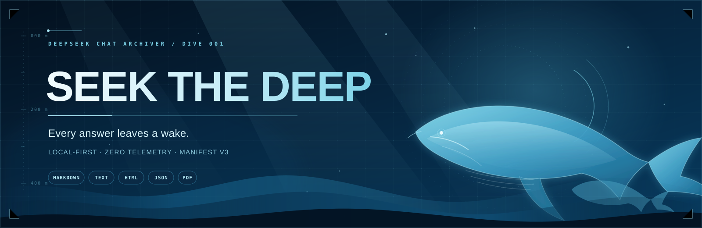
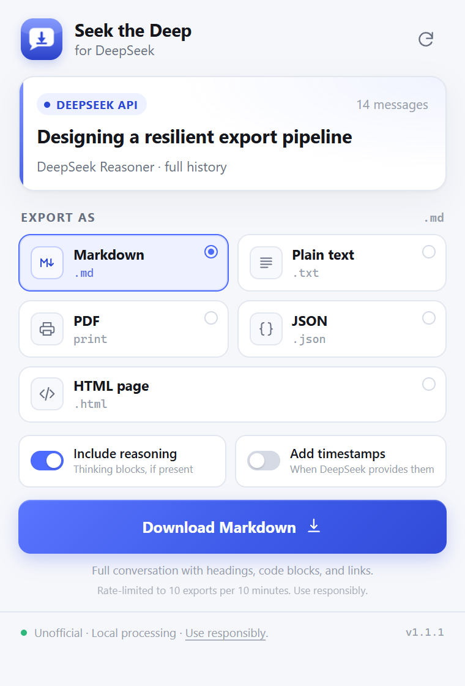
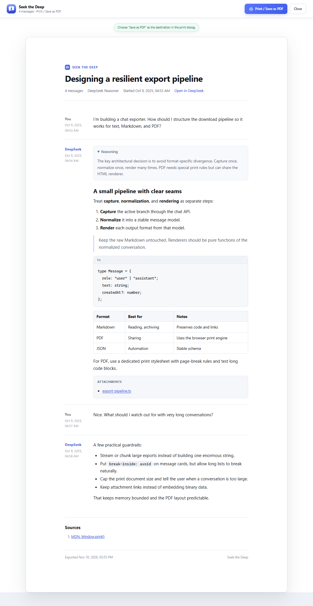

<div align="center">



**A local-first DeepSeek chat exporter for Chrome, Edge, and other Chromium browsers.**

Keep the whole conversation. Take it with you as Markdown, plain text, HTML, JSON, or PDF.

<br />

<p align="center">
  <a href="https://github.com/LeTrollologist/seek-the-deep/releases">
    
  </a>
  <a href="manifest.json">
    
  </a>
  <a href="#formats">
    
  </a>
  <a href="PRIVACY.md">
    
  </a>
  <a href="LICENSE">
    
  </a>
</p>

<p align="center">
  <a href="#install"></a>
  <a href="#formats"></a>
  <br /><br />
  <a href="PRIVACY.md"></a>
  <a href="https://github.com/LeTrollologist/seek-the-deep"></a>
</p>

</div>

---

## Overview

**Seek the Deep** saves the DeepSeek conversation you are reading — including the parts above the scroll — to a file that outlives the tab.

It is a small Manifest V3 extension with no build step, no server, no account, and no runtime dependencies. It asks DeepSeek's own web API for the active branch, renders every format locally, and falls back to the visible page text if the API is unavailable.

> The API is undocumented. The fallback is there for the days it changes.

## What makes it useful

| | |
| --- | --- |
| **Full history** | Captures the active conversation branch through DeepSeek's API, not just the messages currently rendered on screen. |
| **Five exits** | Markdown, plain text, standalone HTML, structured JSON, and print-quality PDF. |
| **Reasoning on request** | Include DeepSeek's thinking blocks when they are available; leave them out when you only want the answer. |
| **Timestamps** | Add message times to Markdown, text, HTML, and PDF exports. |
| **Local by default** | Exports are assembled in your browser. No analytics, no telemetry, no third-party upload. |
| **A PDF worth reading** | The print view uses the browser's own layout and print engine — not a screenshot or an extra PDF library. |

<div align="center">
  
</div>

## Formats

| Format | File | Best for |
| --- | --- | --- |
| Markdown | `.md` | Reading, note-taking, Obsidian, GitHub |
| Plain text | `.txt` | Pasting into another tool or model |
| HTML | `.html` | A standalone, self-contained archive page |
| JSON | `.json` | Backups, scripts, further processing |
| PDF | `.pdf` | Sharing or printing |

Markdown preserves code fences, links, tables, lists, and blockquotes. HTML and PDF render them into a clean document. JSON keeps role, text, reasoning, timestamps, attachments, and sources.

## Install

Requires Chrome 109+ or any Chromium browser with Manifest V3 support.

1. Download the [latest release](https://github.com/LeTrollologist/seek-the-deep/releases/latest/download/seek-the-deep-1.0.0.zip) and unzip it.
2. Open `chrome://extensions/` — or `edge://extensions/`, `brave://extensions/`, etc.
3. Turn on **Developer mode**.
4. Click **Load unpacked** and select the folder containing `manifest.json`.
5. Pin **Seek the Deep** to the toolbar.

Chrome loads the extension from that folder, so keep it in place. To update, replace the files and click the reload icon on the extension card.

> Not on the Chrome Web Store. This is a local, unpacked extension.

## Use

1. Open a conversation at [chat.deepseek.com](https://chat.deepseek.com/).
2. Click the extension icon, or press <kbd>Alt</kbd>+<kbd>Shift</kbd>+<kbd>E</kbd>.
3. Pick a format and click the blue button.
4. For **PDF**, the print view opens in a new tab. Choose **Save as PDF** in the browser dialog.

The popup tells you how many messages were found and whether they came from the API (full history) or the visible page.

<div align="center">
  
</div>

## Privacy

- **No analytics, telemetry, or external servers.**
- The only network request goes to `https://chat.deepseek.com`: the same session you are already using, with the token already stored in that tab.
- Exports are generated locally.
- Preferences live in `chrome.storage.sync`; the current print document is briefly stored in `chrome.storage.local`.
- No remote code is loaded.

Read the full [privacy notes](PRIVACY.md).

## Good to know

- Only the **currently selected branch** is exported. Abandoned edit branches are not included.
- Attachments are exported as **links**, not embedded files.
- PDF uses the browser print dialog on purpose, which gives you page size, margins, and headers for free.
- Very large print jobs are capped at 18 MB. Markdown, text, HTML, and JSON are limited only by browser memory.
- The interface follows your system light/dark preference.

## Development

Plain JavaScript. No bundler, no dependencies.

```text
seek-the-deep/
├── manifest.json
├── background.js       API bridge + print tab
├── shared.js           normalization, Markdown renderer, serializers, CSS
├── content.js          API request orchestration + DOM fallback
├── popup.html/css/js   toolbar popup
├── print.html/css/js   print / Save-as-PDF view
├── assets/             README banner + themed buttons
├── icons/
└── tests/
```

Run the tests:

```bash
node --test tests/shared.test.js
```

Load the folder unpacked, open a chat, and use the popup. Background logs are available from the extension's service worker in `chrome://extensions/`.

## Contributing

Issues and focused pull requests are welcome. If DeepSeek changes its web API or DOM, include the page structure or a minimal reproduction so the fallback selectors can be updated.

## License

MIT. See [LICENSE](LICENSE).

<div align="center">
  <sub>Built for the long dive. No telemetry, no wake.</sub>
</div>
